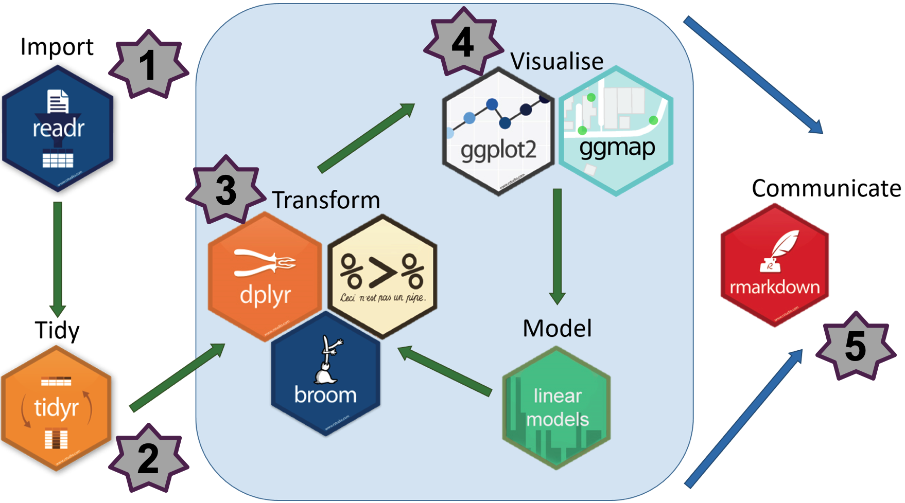

# An Intro to `R`/`Tidyverse`

[Overview](https://github.com/jananiravi/workshop-tidyverse/#overview)
\| [Learning
Objectives](https://github.com/jananiravi/workshop-tidyverse/#learning-objectives)
\| [Setup](https://github.com/jananiravi/workshop-tidyverse/#setup) \|
[Credits](https://github.com/jananiravi/workshop-tidyverse/#credits) \|
[Contact](https://github.com/jananiravi/workshop-tidyverse/#contact) \|
[Additional
Resources](https://github.com/jananiravi/workshop-tidyverse/#additional-resources)

### Next workshop

-  2025: [Sep 12](https://www.meetup.com/rladies-aurora/events/310892519) / [Sep 19](https://www.meetup.com/rladies-aurora/events/310892588) | w/ [R-Ladies Aurora](https://www.meetup.com/rladies-aurora) and [PATH-GREU program](https://www.msudenver.edu/advanced-stem-education/genomics-research-experiences/) | co-hosted with [Harriet Dashnow](https://github.com/hdashnow)

### Past workshops

[Videos](https://github.com/jananiravi/workshop-tidyverse/tree/main/videos)
- 2022: [International Society for Computational Biology, ISCB Academy
Tutorial](https://www.iscb.org/iscbacademy)
- 2021: R-Ladies Tunis, Africa - 2021: R-Ladies Bangalore, India
- 2019: Indian Institute of Technology Madras (IITM) Chennai, India (w/ Praveena Mathews)
- 2019--2022: PBGB R seminar course (Spring of '19, '20, '22), Michigan State University
- Other related ones: [R-Ladies East Lansing](https://github.com/rladies-eastlansing)

------------------------------------------------------------------------

## Overview

This repo contains the workshop material for using R/tidyverse to
analyze & visualize diverse datasets, *e.g.,* [transcriptomics](https://jananiravi.github.io/workshop-tidyverse/transcriptomics/workshop-tidyverse) & [gapminder](https://jananiravi.github.io/workshop-tidyverse/gapminder/workshop-tidyverse-gapminder) [material: [transcriptomics](https://github.com/jananiravi/workshop-tidyverse/tree/main/transcriptomics),
[gapminder](https://github.com/jananiravi/workshop-tidyverse/tree/main/gapminder)].

-   **Part 1: Getting started w/ `readr`**
    -   Installation and Setup \| Cheatsheets
    -   Loading packages
    -   Data import
    -   Knowing your data: *basic data exploration*
-   **Part 2: Reshaping data w/ `tidyr`**
    -   Gather, Spread
    -   Unite, Separate
-   **Part 3: Data wrangling w/ `dplyr`**
    -   Filter, Select
    -   Mutate
    -   Distinct and Arrange
    -   Group_by and Summarize
    -   More data wrangling
-   **Part 4: Visualizing tidy data w/ `ggplot`**
    -   Basics of ggplot
    -   Barplots and histograms
    -   Scatter plots
    -   Boxplots and violin plots
    -   Some data sleuthing!
-   **Part 5. Export and Wrap-up w/ `rmarkdown`**
    -   Saving your plots
    -   Saving your data files
    -   Summary of everything that you learnt in the workshop!

## Learning Objectives

By the end of this workshop, you will be able to load your genomic
dataset, perform basic data tidying & wrangling, data visualization, and
save/export your results using `tidyverse`! Hopefully, you will also
have a newfound appreciation for reproducible research and R!

## Setup

### Before the Workshop Begins

1.  Install the following software if you don't yet have them. If you do
    have these installed, skip to #2:
    1.  **R** version `3.6+` (Current: `4.2.0`) \| [Download
        R](https://www.r-project.org/)
    2.  **RStudio** version `1.3+` (Current: `2022.02.2-485`) \|
        [Download
        RStudio](https://www.rstudio.com/products/rstudio/download/) OR
        use [RStudio Cloud](https://rstudio.cloud)
2.  Ensure that your version of **R** is `4.4+`. The latest version is
    `4.5.1`. To check your R version, type in your console: `version`
3.  Check your **RStudio** version. It should be `2025.05.1+513` or close! Open RStudio.
    In the top menu bar, click: RStudio \> About RStudio \>
4.  Install **tidyverse**, **here**, **gapminder** (not needed for
    transcriptomics workshop), **gganimate**:  
    `install.packages(c("tidyverse", "here", "gapminder"))`  
    `devtools::install_github(‘thomasp85/gganimate’)`
5.  Access useful [Cheatsheets
    here](https://github.com/jananiravi/cheatsheets).

**Other Resources: Software Carpentry Video Tutorial for installing R
and R Studio**

#### For Windows Users

[Video Tutorial](https://www.youtube.com/watch?v=q0PjTAylwoU)  
Install R by downloading and running [this `.exe` file from
CRAN](https://cran.r-project.org/bin/windows/base/release.htm). Also,
please install the [RStudio
IDE](https://www.rstudio.com/products/rstudio/download/#download). Note
that if you have separate user and admin accounts, you should run the
installers as administrator (right-click on `.exe` file and select "Run as
administrator" instead of double-clicking). Otherwise, problems may occur
later, for example, when installing R packages.

#### For Mac Users

[Video Tutorial](https://www.youtube.com/watch?v=5-ly3kyxwEg) Install R
by downloading and running [this `.pkg` file from
CRAN](https://cran.r-project.org/bin/macosx/R-latest.pkg). Also, please
install the [RStudio
IDE](https://www.rstudio.com/products/rstudio/download/#download).

#### For Linux Users

You can download the binary files for your distribution from
[CRAN](https://cran.r-project.org/index.html). Or you can use your
package manager (e.g. for Debian/Ubuntu run
`sudo apt-get install r-base` and for Fedora run `sudo dnf install R`).
Also, please install the [RStudio
IDE](https://www.rstudio.com/products/rstudio/download/#download).

------------------------------------------------------------------------

## Credits

[Arjun Krishnan](https://thekrishnanlab.org) and
[I](https://jravilab.github.io) co-developed the content for the
transcriptomics part for this workshop; [R-Ladies East
Lansing](https://rladies-eastlansing.github.io) members (Kayla J,
Nafiseh H, Veronica F, Cara F, Camille A) and I helped with the
`gapminder` material.

### Acknowledgements

-   [Krishnan Lab](https://thekrishnanlab.org) \|
    [JRaviLab](https://jravilab.github.io)
-   [R-Ladies East Lansing](https://meetup.com/rladies-eastlansing),
    incl. Nafiseh Haghtalab, Kayla Johnson, Veronica Frans, Cara
    Feldscher, Camille Archer
-   [R-Ladies Aurora](https://meetup.com/rladies-aurora) \| [R-Ladies Chennai](https://meetup.com/rladies-chennai) \| [R-Ladies
    Bangalore](https://meetup.com/rladies-bangalore) \| [R-Ladies
    Tunis](https://meetup.com/rladies-tunis)

### License

This work is licensed under a BSD-3-Clause License.

### Contributing

-   If you like it, leave your star in this project 🌟
-   If you would like to suggest/contribute to this project, or request similar ones, feel free
    to [open an issue](https://github.com/jananiravi/workshop-tidyverse/issues) 💟
-   Please follow our contributing guidelines (coming soon!).

## Contact

-   Webpage: [jravilab.github.io](https://jravilab.github.io) \|
    [thekrishnanlab.org](https://thekrishnanlab.org) \|
    [github.com/rladies-eastlansing](https://github.com/rladies-eastlansing)
-   Email: [janani.ravi\@cuanschutz.edu](mailto:janani.ravi@cuanschutz.edu) \|
    [arjun.krishnan\@cuanschutz.edu](mailto:arjun.krishnan@cuanschutz.edu)
-   GitHub: [\@jananiravi](https://github.com/jananiravi) \|
    [\@arjunkrish](https://github.com/arjunkrish) \|
    [\@RLadies-EastLansing](https://github.com/rladies-eastlansing)

------------------------------------------------------------------------

## Additional resources

-   You can access all relevant material pertaining to this workshop
    [here](https://jananiravi.github.io/workshop-tidyverse).
-   Other related [RLA](https://github.com/rladies-aurora) \| [RLEL
    workshops](http://github.com/rladies-eastlansing/meetup-presentations)
    & useful [cheatsheets](http://github.com/jananiravi/cheatsheets).
-   [Computational Biology/Bioinformatics
    Resources](https://github.com/jananiravi/compbio-gists) collated by
    Arjun and Janani.
-   [Data-to-viz.com](https://www.data-to-viz.com) & [R Graph
    Gallery](https://www.r-graph-gallery.com) \| [Python Graph Gallery](https://python-graph-gallery.com)

### Some awesome open-source books

-   R for Data Science: Wickham & Grolemund #R4DS
    <https://r4ds.had.co.nz>
-   Hands-On Programming with R: Grolemund #HOPR
    <https://rstudio-education.github.io/hopr>
-   R Programming for Data Science: Peng
    <https://leanpub.com/rprogramming>
-   Learning Statistics with R: Navarro
    <https://learningstatisticswithr.com/book>
